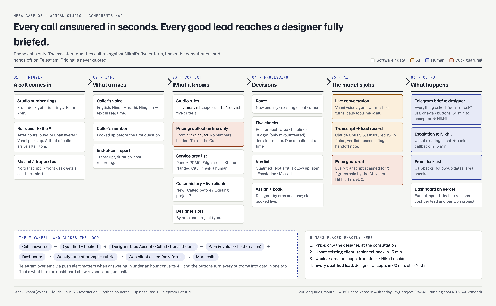

# Aangan Voice Desk

An AI phone desk for **Aangan Studio**, an interior design studio in Pune (MESA Case 03).

Every call is answered day or night. The assistant:
- checks the caller against the founder's five criteria,
- books a consultation,
- sends the designer a complete brief on Telegram.

It never quotes a price.



## The problem
- About 200 enquiries a month come in, and about 48% get no reply within 48 hours.
- About a third arrive after 7pm, when the front desk has gone home.
- Calls answered within an hour convert 4× better than calls answered the next day.
- When a lead does reach a designer, it arrives with no context, so the first call is spent re-asking the same questions.

## What's in this repo

| Path | What it is |
|---|---|
| `api/index.py` | The whole backend (one Vercel Python function): Vaani mid-call tools, end-of-call processing with Claude, Telegram handoff and buttons, the SLA sweep, stats |
| `public/index.html` | Dashboard. Replay any of the 20 real September calls through the live system, tap through the designer's outcome buttons, and see funnel and cost |
| `public/components-map.html` | Components map (Trigger → Input → Context → Processing → AI → Output) |
| `data/test_calls.json` | The 20 phone transcripts from the case, with the expected decision for each |
| `tests/test_local.py` | End-to-end test of the backend with Claude stubbed out (31 checks) |
| `vaani/` | Agent prompt and function definitions to paste into Vaani |
| `docs/NINE-CHECKS.md` | The nine checks, and the Cut (per-sq-ft pricing) |

## How a call flows
1. **Call starts.** Vaani calls `check_caller`, which returns new, repeat enquiry, or existing client. An existing client goes straight to `escalate`: Nikhil is alerted for a 15-minute callback.
2. **Qualify.** The agent works through the five criteria one question at a time, and deflects any pricing question with the approved line.
3. **Book.** `get_slots` → `book_consult` books a designer matched by area and current workload.
4. **Call ends.** `call_ended` receives the transcript. Claude Opus 5.5 turns it into a structured lead record (fields, verdict, reasons, flags, handoff note). A separate check scans the transcript for any ₹ figure the AI said.
5. **Route:**
   - Qualified → Telegram brief to the designer, with Accept / Called / Consult done / Won / Lost buttons.
   - Escalation → Nikhil.
   - Follow up later → the front desk list, with a date.
   - Missed call → a call-back alert.
6. **Close the loop.** Each designer tap is written back to the lead. If nobody accepts within 60 minutes of studio time, Nikhil is alerted. The dashboard shows the funnel, the won ₹ value and the cost per call, per qualified lead and per won project.

## Deploy
1. Import this repo into Vercel (framework preset: **Other**).
2. **Storage:** go to Storage → add **Upstash Redis** (free tier). Vercel sets `KV_REST_API_URL` and `KV_REST_API_TOKEN` for you.
3. **Environment variables:**

| Name | Required | Notes |
|---|---|---|
| `ANTHROPIC_API_KEY` | yes | console.anthropic.com |
| `WEBHOOK_SECRET` | yes | Any long random string. Protects the Vaani and Telegram endpoints |
| `TELEGRAM_BOT_TOKEN` | for handoff | Create a bot with @BotFather |
| `TELEGRAM_CHAT_ID` | for handoff | Your chat ID. Used for all roles in the demo |
| `NIKHIL_CHAT_ID`, `FRONTDESK_CHAT_ID`, `DESIGNERS_JSON` | optional | Separate chats per role in production |
| `VOICE_RATE_PER_MIN_INR` | optional | Default 8 |
| `FIXED_MONTHLY_INR` | optional | Default 1500 |
| `CLAUDE_EFFORT` | optional | Default `medium` |

4. **Redeploy.** Then connect Telegram button taps once:
   ```
   curl -X POST "https://<app>.vercel.app/api/setup-telegram?key=<WEBHOOK_SECRET>"
   ```
5. **Vaani:** paste `vaani/system-prompt.md` into the agent. Add the functions from `vaani/functions.json` (URL format `https://<app>.vercel.app/api/vaani/<name>?key=<WEBHOOK_SECRET>`), and set the end-of-call webhook to `/api/vaani/call_ended`.

## Test
- **Locally, no keys needed:** `python3 tests/test_local.py`
- **Live:** open the Vercel URL, pick a call (T01 qualified, T09 escalation, T07 follow-up, T03 outside area), and press **Replay this call**.

## Design decisions
- **The Cut, per-sq-ft pricing.** Nikhil asked for it, but his own `pricing.md` forbids quoting any number. The ranges also vary hugely (₹1,800 to ₹3,500+ per sq ft), so any number said on a call becomes an anchor the designer has to argue against. The agent deflects and books instead, and every pricing question is counted so the decision can be revisited with data.
- **Telegram over email.** A push alert is what makes "answered within an hour" happen. The inline buttons turn every outcome into data in one tap, and those taps are what close the flywheel. The daily digest also goes to Nikhil on Telegram.
- **Budget is never asked.** It's checked only when the caller volunteers a clearly misaligned number, as `qualified.md` says.
- **Unclear areas go to people, not to a decline.** Kharadi and Nanded City are flagged for the front desk instead of being turned away.

## Limits
- Vercel's free plan runs scheduled jobs once a day (10am IST). The 60-minute SLA check also runs every time the dashboard loads.
- Booking uses rolling slots (Mon–Sat, 11:00 and 16:00, per designer) rather than real designer calendars.
- Without Upstash Redis, data is kept in memory and resets when the function restarts.
